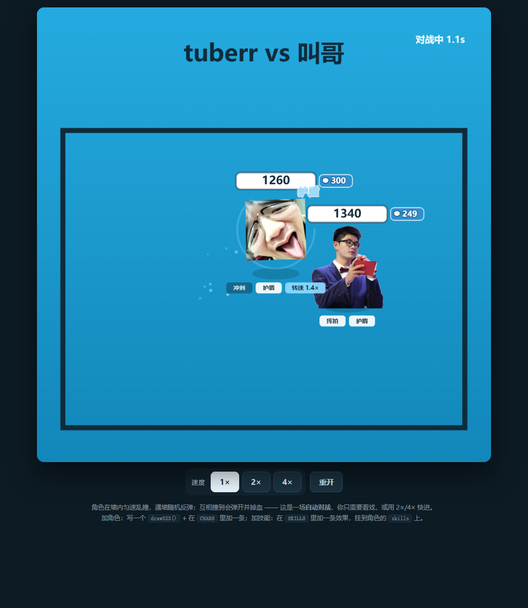
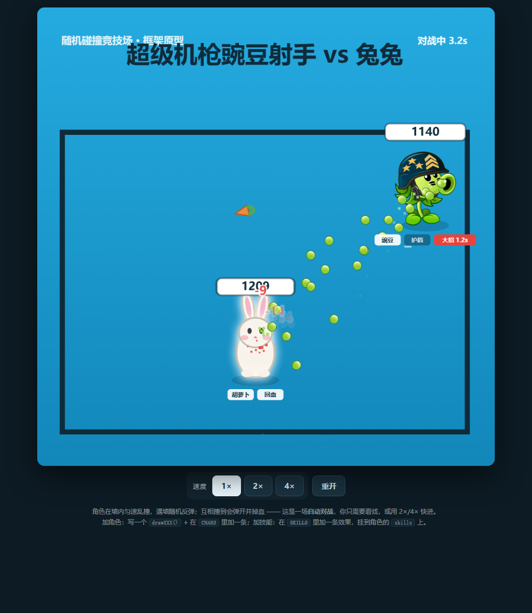

# 神人对战游戏

两个角色在矩形擂台里随机碰撞、遇墙反弹，各自自动放技能互相攻击，头顶血条见底定胜负。

纯前端单页小游戏（HTML5 Canvas），**零依赖、零构建、无后端**——双击 `index.html` 就能玩。



## 玩法

- 角色不受操控：在擂台内匀速乱飞，撞墙随机反弹，互相撞到会弹开并掉血
- 每个角色有自己的技能组，冷却好了自动放，AI 根据距离和血量决定什么时候放
- 头顶白色圆角框就是血条，**宽度随血量收缩**；名字只显示在屏幕顶部的「A vs B」标题里
- 一方血量归零 → 结算页（再来一局 / 换角色 / 主界面）

## 角色

| 角色 | 血量 | 速度 | 技能 |
| --- | --- | --- | --- |
| 凑企鹅 | 1350 | 标准 | 石块（弹药 20 发）· 滑铲（位移冲撞） |
| 猫猫 | 980 | 快 | 连爪（三段近战）· 扑击（突进）· 护盾 |
| 兔兔 | 1260 | 偏慢 | 胡萝卜（弹跳投掷）· 回血 |
| 超级机枪豌豆射手 | 1140 | 慢 | 豌豆（四连发依次射出，每颗 3% 触发大招）· 护盾 |
| 叫哥 | 1340 | 偏慢 | **挥拍**（网球拍扇形近战，反弹子弹 + 击退）· 护盾 |

**超级机枪豌豆射手的大招**：触发后在正前方 30° 扇形内持续 2 秒高速扫射。
**叫哥的挥拍**：正面 ±54°、半径 410 的大扇形，命中造成 **96 伤害 + 强力击退**（速度 1900，持续 0.5 秒）；
扇形内的敌方子弹会被拍回去（伤害 ×1.5，并改判为叫哥的攻击）。

- **自动弹反**：不用等技能冷却，只要正前方有子弹朝自己飞来，叫哥会自动挥拍把它拍回去（内置 0.4 秒短冷却，避免连击刷屏）。
- **撞墙眩晕**：被击退的角色如果撞到擂台墙，会**眩晕 1 秒**（头顶转小星星、不能移动也不能放技能）。



## 操作

| 界面 | 操作 |
| --- | --- |
| 主界面 | 点「开始对战」，或按空格 |
| 选人 | 点角色卡放入高亮槽位；点另一个槽位可换边；`随机` 一键配 |
| 战斗 | 底部 `1× / 2× / 4×` 加速，`重开` 换一局；纯观看，无需操作 |
| 通用 | `Esc` 返回上一层 |

## 本地运行

最简单：双击 `index.html`。

想用本地服务器（手机同 Wi-Fi 也能玩）：

```bash
python -m http.server 8000
# 浏览器打开 http://localhost:8000
```

## 部署到 GitHub Pages

1. 把仓库推上 GitHub；
2. 仓库 **Settings → Pages**；
3. Source 选 `Deploy from a branch`，Branch 选 `main` + `/ (root)`，保存；
4. 等半分钟，访问 `https://<你的用户名>.github.io/<仓库名>/`。

> 仓库根目录的 `.nojekyll` 用来跳过 Jekyll 处理，保证静态文件原样发布。

## 手机 / 平板

页面做了移动端适配：窄屏时全屏界面铺满视口、角色卡自动两列、画布按宽度等比缩放，横竖屏都能玩。

## 技术要点

- **固定步长 1/60 模拟**：渲染用 `requestAnimationFrame`，逻辑用累加器补步，2×/4× 加速不会改变战斗结果
- **种子随机**（mulberry32）：同一个种子能完整复现一场战斗，方便回放/复盘/做平衡测试
- **技能即数据**：`SKILLS` 表里一个技能 = 冷却 + 施法条件 + 效果函数；`CHARS` 表里一个角色 = 属性 + 立绘 + 技能 key 列表，加角色只改数据不动引擎
- **效果原语**：投掷物 / 多段近战 / 位移 / 延迟结算 / 增益治疗，组合即可拼出新技能
- **血条即进度条**：白色圆角框宽度 = 血量百分比，低血时数字转红
- **贴图异步自愈**：头像画布登记后统一重绘，加载完成 / 切界面都会刷新，不会停在占位图上

## 目录结构

```
.
├── index.html            # 页面外壳：加载页 / 主界面 / 选人 / 结算
├── game.js               # 全部游戏逻辑：实体、技能表、角色表、世界循环
├── sprites.js            # 自动生成：贴图内联成 data URI（移动端不依赖图片请求）
├── assets/               # 原始 PNG（构建时会被内联进 sprites.js）
├── screenshots/          # README 用截图
└── .nojekyll
```

> `sprites.js` 由 `build.ps1` 从 `assets/` 生成。贴图内联后，手机浏览器不会再因为图片请求失败/缓存而显示占位图。

## 说明

角色贴图来自网络素材，仅用于个人学习/演示；如果要商用请替换成自有素材（换图方式见仓库内 `ART` 配置，改文件名和炮口坐标即可）。
